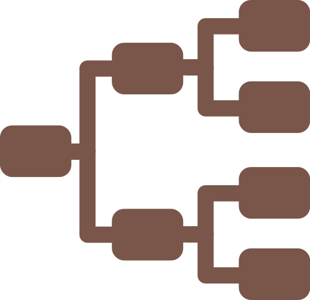

# Despliegue de Gramps Web sobre Debian 13 Trixie

Manual de instalación, publicación y operación de Gramps Web —el sistema de genealogía colaborativa del proyecto Gramps— sobre un servidor Debian 13 ya instalado y endurecido. Usa Docker Compose con imágenes fijadas por versión, Cloudflare como borde y Caddy como proxy inverso en el origen, respaldos con BorgBackup y una política de roles pensada para que el árbol sobreviva a quien lo instaló.

<p style="text-align: center"></p>

Cubre solo la capa de aplicación: el sistema base lo pone el manual de Debian y la publicación detrás del borde, el de Caddy. Las variables se declaran en la sección 1 y se reutilizan en todo el documento.

## a. Historial de cambios

- `[0.2]` – 2026-10-18
  - Publicación solo detrás de Cloudflare (ruta B del manual de Caddy): certificado de origen ECC, 443 abierto a los rangos del borde en UFW y en el firewall del proveedor, y regla de límite de ritmo sobre las rutas de credenciales.
  - Caddyfile con cabeceras de seguridad, bloqueo de escáneres adaptado a la SPA, sin escucha en 80 ni UDP, `jwt` redactado en el log, rotación de 50 MiB y caché de un año para los JavaScript con hash.
  - Imágenes fijadas con etiqueta y digest en el `.env` (`GW_IMAGEN`, `GW_IMAGEN_VALKEY`); actualización (11.1) como cambio de una línea, con vuelta atrás condicionada al esquema.
  - Migración (sección 12) ejecutada en real: transferencia sin alias SSH, permisos tras extraer, conteos y prueba de Celery de punta a punta (8.1).
  - Nuevos hallazgos operativos: limitador de Gramps compartido por todos los visitantes, aviso de registro al confirmar el correo (9.2), telemetría (4.3) y tareas atascadas (B.15).
  - Correcciones de `UMASK 027`, grupo `docker` retirado (2.4), revisión de coherencia completa y referencias al final.
- `[0.1]` – 2026-10-18
  - Redacción inicial. Pila Docker Compose (grampsweb + celery + valkey), Caddy como proxy inverso, respaldos por bind mount.

## b. To-do

- Validar las secciones 10 (respaldos, con la prueba de restauración de 10.4) y 11 (actualización) en el despliegue real, y marcar la versión como v1.0. Las Etapas I a IV, la sección 12 salvo 12.9 y las reglas de Cloudflare ya se ejecutaron en servidor real.
- Escribir el hook `pre-backup` de BorgBackup como script versionado.
- Validar la vuelta atrás y el retiro del origen de 12.9.
- Validar la variante con Amazon SES de 7.4.
- Corregir y validar en VM el túnel del Anexo E.3 frente al `DisableForwarding yes` del manual de Debian actual: archivo leído antes que `01-hardening.conf` y `Match` con `DisableForwarding no`.
- Completar la variante STARTTLS en el 587 (7.1 y 7.2): comprobar en `config.py` el nombre de la opción, llevarla al `environment:` y adaptar la prueba de 7.2, que hoy usa `SMTP_SSL`.
- Comprobar si Valkey persiste los estados de Celery (`valkey-cli CONFIG GET save` y sus montajes). Si persiste, corregir B.15; si no, la 10.3 debería detener solo `grampsweb` y `grampsweb_celery`, para no dejar tareas huérfanas en cada respaldo.
- Evaluar `env_file:` en el compose, o las variables de correo desde 4.1, para no editar el YAML a mano en 7.1; validar el tratamiento del `$` y el arranque con el correo vacío.
- Evaluar un `docker save` de las dos imágenes fijadas hacia `backup/` en cada actualización, para no depender de que ghcr.io siga sirviendo el digest (Anexo D).
- Validar si `hostname` y `domainname` (4.1) mejoran la clasificación del correo como spam.
- Validar la desactivación de la telemetría con `GRAMPSWEB_DISABLE_TELEMETRY` (4.3), comprobada solo en el código.
- Validar en la próxima actualización (11.1) que la caché de los archivos con hash de 5.4 no deja ningún navegador con el frontend anterior.
- Ajustar los procesos y el tiempo de espera de gunicorn y la concurrencia de Celery (4.1) a la CPU y la memoria del servidor, comprobando antes qué variables acepta la imagen.
- Probar la subida de un archivo cerca del límite de 100 MB de 5.4: por debajo debe entrar, y por encima Cloudflare debe responder `413` sin que la petición llegue a Caddy.
- Revisar en `Security → Analytics`, tras unos días de uso, que la regla de 6.3 no actúa sobre usuarios legítimos.
- Evaluar una regla personalizada de Cloudflare que bloquee en el borde las rutas de escaneo que 5.4 ya responde con `404`.
- Documentar la migración de SQLite a PostgreSQL cuando el árbol lo justifique.
- Evaluar OIDC contra un proveedor propio, para no depender de contraseñas locales.
- Documentar Gramps Web Sync con capturas del flujo bidireccional (Anexo C).

## c. Requerimientos previos

- Un servidor Debian 13 Trixie instalado y endurecido según el [manual de despliegue de Debian 13 Trixie server](../../Sistemas%20Operativos/debian/13-server.md): usuario administrativo en `sudo`, SSH por llave Ed25519, UFW activo y root bloqueado.
- Un dominio cuya zona DNS gestione Cloudflare, con acceso al panel para crear el registro con proxy, fijar el modo de cifrado y emitir un certificado de origen.
- El 443/tcp del servidor alcanzable solo desde los rangos de Cloudflare. El borde termina el TLS del visitante y abre otra conexión TLS hacia Caddy, que presenta un certificado de Cloudflare Origin CA. No se usa Let's Encrypt —con el proxy activo, `tls-alpn-01` nunca llega al servidor— ni el puerto 80, porque la redirección a HTTPS la hace el borde. Es la ruta B del [manual de Caddy](../caddy/README.md).
- Al menos 2 GiB de RAM. Con 1 GiB la pila arranca, pero la reindexación de árboles grandes muere por falta de memoria.
- Opcionalmente, un buzón SMTP con autenticación (sección 7). Sin él no hay recuperación de contraseñas y toda alta pasa por el administrador.

> Para ensayar en una VM de laboratorio, sin dominio ni IP pública, conviene leer primero el [Anexo E](#anexo-e--modo-laboratorio-sin-dominio-ni-tls): indica qué se omite y qué ajuste de `sshd` requiere el túnel.

---

## Índice

### Etapa I — Preparación del anfitrión

#### 1. Variables del despliegue y validación del punto de partida

- [1.1 Diccionario de variables](#11-diccionario-de-variables)
- [1.2 Validación del sistema base](#12-validación-del-sistema-base)
- [1.3 Registro DNS y cifrado en Cloudflare](#13-registro-dns-y-cifrado-en-cloudflare)

#### 2. Docker Engine y Compose

- [2.1 Retiro de paquetes conflictivos](#21-retiro-de-paquetes-conflictivos)
- [2.2 Llavero y repositorio oficial de Docker](#22-llavero-y-repositorio-oficial-de-docker)
- [2.3 Instalación del motor y los complementos](#23-instalación-del-motor-y-los-complementos)
- [2.4 Comprobación de la instalación y grupo docker](#24-comprobación-de-la-instalación-y-grupo-docker)

### Etapa II — Despliegue de la pila

#### 3. Estructura de directorios y secretos

- [3.1 Árbol de trabajo](#31-árbol-de-trabajo)
- [3.2 Generación de la llave secreta de Flask](#32-generación-de-la-llave-secreta-de-flask)
- [3.3 Archivo de entorno](#33-archivo-de-entorno)

#### 4. Composición de servicios

- [4.1 El archivo docker-compose.yml](#41-el-archivo-docker-composeyml)
- [4.2 Por qué unos volúmenes son bind mount y otros no](#42-por-qué-unos-volúmenes-son-bind-mount-y-otros-no)
- [4.3 Primer arranque y verificación local](#43-primer-arranque-y-verificación-local)

### Etapa III — Publicación y correo

#### 5. Proxy inverso con Caddy

- [5.1 Instalación de Caddy y directorio de logs](#51-instalación-de-caddy-y-directorio-de-logs)
- [5.2 Certificado de origen de Cloudflare](#52-certificado-de-origen-de-cloudflare)
- [5.3 Rangos de Cloudflare](#53-rangos-de-cloudflare)
- [5.4 Caddyfile](#54-caddyfile)
- [5.5 Arranque y comprobación local](#55-arranque-y-comprobación-local)

#### 6. Cortafuegos y superficie expuesta

- [6.1 Apertura del 443 a Cloudflare](#61-apertura-del-443-a-cloudflare)
- [6.2 La trampa de Docker y UFW](#62-la-trampa-de-docker-y-ufw)
- [6.3 Límite de ritmo en Cloudflare](#63-límite-de-ritmo-en-cloudflare)

#### 7. Correo saliente

- [7.1 Variables SMTP](#71-variables-smtp)
- [7.2 Verificación de la configuración](#72-verificación-de-la-configuración)
- [7.3 Autenticación del remitente: SPF, DKIM y DMARC](#73-autenticación-del-remitente-spf-dkim-y-dmarc)
- [7.4 Variante: Amazon SES como relevo SMTP](#74-variante-amazon-ses-como-relevo-smtp)

### Etapa IV — Configuración funcional

#### 8. Asistente de primera ejecución

- [8.1 Creación de la cuenta propietaria](#81-creación-de-la-cuenta-propietaria)
- [8.2 Importación del árbol existente](#82-importación-del-árbol-existente)

#### 9. Roles y administración multiusuario

- [9.1 Los seis roles y qué habilita cada uno](#91-los-seis-roles-y-qué-habilita-cada-uno)
- [9.2 Alta de usuarios](#92-alta-de-usuarios)
- [9.3 Diseño de una política de acceso familiar](#93-diseño-de-una-política-de-acceso-familiar)

### Etapa V — Operación

#### 10. Respaldos

- [10.1 Qué respaldar y qué no](#101-qué-respaldar-y-qué-no)
- [10.2 Exportación lógica periódica](#102-exportación-lógica-periódica)
- [10.3 Integración con BorgBackup](#103-integración-con-borgbackup)
- [10.4 Prueba de restauración](#104-prueba-de-restauración)

#### 11. Actualización

- [11.1 Procedimiento estándar](#111-procedimiento-estándar)
- [11.2 Saltos de versión mayor](#112-saltos-de-versión-mayor)

#### 12. Migración a un nuevo servidor

- [12.1 Estrategia](#121-estrategia)
- [12.2 Variables y preparativos con antelación](#122-variables-y-preparativos-con-antelación)
- [12.3 Inventario del origen](#123-inventario-del-origen)
- [12.4 Preparación del destino](#124-preparación-del-destino)
- [12.5 Corte en el origen: detención y empaquetado](#125-corte-en-el-origen-detención-y-empaquetado)
- [12.6 Transferencia y arranque en el destino](#126-transferencia-y-arranque-en-el-destino)
- [12.7 Cambio del origen en Cloudflare](#127-cambio-del-origen-en-cloudflare)
- [12.8 Verificación funcional y tareas posteriores](#128-verificación-funcional-y-tareas-posteriores)
- [12.9 Vuelta atrás y retiro del origen](#129-vuelta-atrás-y-retiro-del-origen)

### Anexos

- [Anexo A — Diccionario consolidado de variables y rutas](#anexo-a--diccionario-consolidado-de-variables-y-rutas)
- [Anexo B — Diagnóstico rápido por síntoma](#anexo-b--diagnóstico-rápido-por-síntoma)
- [Anexo C — Sincronización con Gramps de escritorio](#anexo-c--sincronización-con-gramps-de-escritorio)
- [Anexo D — Runbook de sucesión administrativa](#anexo-d--runbook-de-sucesión-administrativa)
- [Anexo E — Modo laboratorio, sin dominio ni TLS](#anexo-e--modo-laboratorio-sin-dominio-ni-tls)

---

## Etapa I — Preparación del anfitrión

> Para trasladar una instancia que ya funciona en otro servidor, el procedimiento empieza en la sección 12, que indica qué partes de este manual ejecutar en el destino.

### 1. Variables del despliegue y validación del punto de partida

Antes de instalar se fijan los valores que se repiten en todo el manual y se confirma que el servidor está como lo deja el manual base. Lo que suele fallar no es Gramps Web sino el entorno: DNS, puertos o memoria.

#### 1.1 Diccionario de variables

Ajusta los valores a tu caso; los bloques siguientes los usan tal cual.

```bash
export GW_FQDN="genealogia.ejemplo.com"      # nombre público del servicio
export GW_TREE="Familia Rodríguez"             # nombre del árbol; se crea si no existe
export GW_BASE="/srv/grampsweb"             # raíz del despliegue en el anfitrión
export GW_ADMIN="usuario"                      # usuario del sistema que opera la pila
export GW_TZ="America/Lima"                 # zona horaria de los contenedores
export GW_IFACE="$(ip -o -4 route show to default | awk '{print $5}' | head -1)"
export GW_IP4="$(ip -o -4 addr show "${GW_IFACE}" | awk '{print $4}' | cut -d/ -f1 | head -1)"
printf 'interfaz=%s ip=%s\n' "${GW_IFACE}" "${GW_IP4}"
```

`GW_IP4` es la IPv4 pública a la que apuntará el registro de Cloudflare. Detrás de NAT la deducción da la IP privada, y el valor se toma del panel del proveedor.

> Las variables solo viven en la sesión del shell; si la cierras, vuelve a exportarlas. El Anexo A las repite consolidadas.

#### 1.2 Validación del sistema base

```bash
. /etc/os-release && printf '%s (%s)\n' "${PRETTY_NAME}" "${VERSION_CODENAME}"
dpkg --print-architecture
free -h | awk 'NR==1 || NR==2'
df -h /srv /var/lib/docker 2>/dev/null
sudo ufw status verbose
timedatectl show -p Timezone --value
```

Se espera `Debian GNU/Linux 13 (trixie)`, al menos 2 GiB de memoria, espacio holgado y UFW `active`. Que falten `/var/lib/docker` o `/srv` es normal: aún no existe o no es un montaje propio.

Una instalación mínima no trae `curl` ni `dig`, necesarios en 1.3 y 2.2:

```bash
sudo apt update && sudo apt install -y ca-certificates curl gnupg bind9-dnsutils
```

El servidor no debe resolver el nombre del servicio a sí mismo: si `${GW_FQDN}` coincide con el nombre del equipo, la línea `127.0.1.1` de `/etc/hosts` haría que las comprobaciones de 1.3 y 5.5 no llegaran a Cloudflare.

```bash
getent hosts "${GW_FQDN}"     # sin salida antes de 1.3; nunca 127.0.1.1
```

Si devuelve `127.0.1.1`, quita el nombre del servicio de esa línea.

> Con 2 GiB justos, revisa antes la guía oficial de limitación de CPU y memoria:
> <https://www.grampsweb.org/install_setup/cpu-limited/>. El trabajador Celery con
> `--concurrency=2` es lo que más memoria retiene.

#### 1.3 Registro DNS y cifrado en Cloudflare

> En modo laboratorio esta subsección se omite. Ve al Anexo E.

El registro se crea con el proxy activo desde el principio (ruta B del [manual de Caddy](../caddy/README.md), 1.2 y 1.4): ningún certificado depende de él y la IP del servidor no llega a publicarse. Full (strict) y la redirección a HTTPS se aplican en 6.1.

En la zona DNS, crea un registro `A` `${GW_FQDN}` → `${GW_IP4}` con proxy. Un `AAAA` es opcional. El certificado de borde gratuito cubre solo el apex y el primer nivel de subdominios (C.6 del manual de Caddy).

```bash
dig +short "${GW_FQDN}" A          # paquete bind9-dnsutils
dig +short @1.1.1.1 "${GW_FQDN}" A
echo "${GW_IP4}"
curl -s "https://${GW_FQDN}/cdn-cgi/trace" | grep -E '^(h|tls|visit_scheme)='
```

Los `dig` deben devolver direcciones de Cloudflare, no `${GW_IP4}`; si no, el registro está sin proxy. `/cdn-cgi/trace` lo responde el borde, y `h=` con el nombre confirma el proxy.

Dos trampas habituales:

- La consulta a `@1.1.1.1` agota el tiempo: muchas redes bloquean el UDP/53 saliente. Basta entonces la primera consulta, que usa el resolutor del sistema, o una herramienta web por HTTPS como `dnschecker.org`.
- `getent` o `curl` devuelven `127.0.1.1`: viene de `/etc/hosts`, no del DNS (1.2). `dig` no lee ese archivo y por eso muestra la respuesta correcta.

Con el proxy activo, ninguna resolución pública devuelve ya la IP del servidor. Anótala en la bitácora: hace falta para entrar por SSH y para 6.2.

---

### 2. Docker Engine y Compose

Gramps Web se distribuye solo como imagen de contenedor. Docker se instala desde su repositorio oficial y no desde `docker.io` de Debian, que se queda atrás entre versiones.

#### 2.1 Retiro de paquetes conflictivos

Si hubo una instalación previa de contenedores, se retira para que APT no mezcle versiones:

```bash
apt list --installed 2>/dev/null | grep -Ei 'docker|containerd|runc' || echo "sin paquetes previos"
sudo apt remove -y docker.io docker-doc docker-compose podman-docker containerd runc 2>/dev/null || true
```

El `|| true` evita que se detenga cuando no hay nada que retirar, que es lo esperado.

#### 2.2 Llavero y repositorio oficial de Docker

El llavero dedicado y `signed-by` hacen que esa llave solo valide paquetes de ese repositorio.

```bash
sudo install -m 0755 -d /etc/apt/keyrings
sudo curl -fsSL https://download.docker.com/linux/debian/gpg \
  -o /etc/apt/keyrings/docker.asc
sudo chmod a+r /etc/apt/keyrings/docker.asc

echo "deb [arch=$(dpkg --print-architecture) signed-by=/etc/apt/keyrings/docker.asc] https://download.docker.com/linux/debian $(. /etc/os-release && echo "${VERSION_CODENAME}") stable" \
  | sudo tee /etc/apt/sources.list.d/docker.list > /dev/null
sudo chmod 0644 /etc/apt/sources.list.d/docker.list

sudo apt update
```

Los `chmod` responden a la `UMASK 027` del manual base: sin ellos, el llavero queda en 0640 y APT, que verifica firmas como `_apt`, no puede leerlo. El nombre en clave sale de `/etc/os-release` para no equivocarlo.

#### 2.3 Instalación del motor y los complementos

```bash
sudo apt install -y docker-ce docker-ce-cli containerd.io \
  docker-buildx-plugin docker-compose-plugin

sudo systemctl enable --now docker
docker --version && docker compose version
```

`docker compose` sin guion es el complemento Compose, que desde la v2 sustituyó al ejecutable `docker-compose`; un procedimiento que pida este último está escrito para la v1.

#### 2.4 Comprobación de la instalación y grupo docker

La instalación se comprueba con un contenedor de prueba, que se borra con su imagen:

```bash
sudo docker run --rm hello-world && sudo docker image rm hello-world
```

Se espera `Hello from Docker!` y, al final, las líneas `Untagged` y `Deleted`.

El usuario administrativo no se añade al grupo `docker`, que equivale a root sin contraseña, y aquí no aporta nada porque Compose va siempre con `sudo` (4.3). Si una instalación anterior lo añadió, se retira; rige desde el siguiente inicio de sesión:

```bash
getent group docker
sudo gpasswd -d "${GW_ADMIN}" docker
```

Si `${GW_ADMIN}` no era miembro, `gpasswd` lo dice y no cambia nada.

---

## Etapa II — Despliegue de la pila

### 3. Estructura de directorios y secretos

La pila tiene tres contenedores: la aplicación (API y frontend en una imagen), un trabajador Celery para las tareas largas —importaciones, informes, reindexado— y Valkey como intermediario de mensajes y almacén del limitador de peticiones.

#### 3.1 Árbol de trabajo

```bash
sudo mkdir -p "${GW_BASE}"/{data/{db,users,media,secret},backup}
sudo chown -R root:root "${GW_BASE}"
sudo chown root:"${GW_ADMIN}" "${GW_BASE}"    # solo el directorio raíz cambia de grupo
sudo chmod 750 "${GW_BASE}"
ls -la "${GW_BASE}"
```

Los contenedores corren como root, así que `data/` pertenece a root y no se le ajustan permisos. Solo el directorio raíz cede el grupo a `${GW_ADMIN}`, para que el usuario administrativo pueda entrar; el `.env` sigue en modo 600 y de root.

> `data/db` debe estar vacío en el primer arranque. Un árbol de otra instalación no se
> copia aquí: se importa por la web (8.2). Copiarlo acopla el esquema de tu Gramps de
> escritorio con el de la imagen y suele acabar en un servicio que no arranca.

#### 3.2 Generación de la llave secreta de Flask

La llave firma los tokens de sesión: si cambia, todos deben volver a autenticarse; si se filtra, cualquiera puede falsificarlos.

```bash
export GW_SECRET="$(python3 -c "import secrets;print(secrets.token_urlsafe(32))")"
printf '%s\n' "${GW_SECRET}"
```

Guarda el valor que muestra el `printf` en el gestor de secretos: 3.3 lo escribe en el `.env` desde la variable, y debe replicarse en cualquier restauración.

> La imagen genera una llave por sí sola en el volumen `secret` si la variable no existe.
> Declararla la hace parte del respaldo del `.env`, que es más difícil de olvidar.

#### 3.3 Archivo de entorno

Las imágenes se fijan con etiqueta y digest en lugar de `latest` (4.1). Las etiquetas son `26.9.1` para Gramps Web, sin `v`, y `8.1.10-alpine` para Valkey. Las últimas versiones de Gramps Web se listan así:

```bash
T="$(curl -s "https://ghcr.io/token?scope=repository:gramps-project/grampsweb:pull" \
  | python3 -c 'import json, sys; print(json.load(sys.stdin)["token"])')"
curl -s -H "Authorization: Bearer ${T}" "https://ghcr.io/v2/gramps-project/grampsweb/tags/list?n=2000" \
  | python3 -c 'import json, sys; print("\n".join(json.load(sys.stdin)["tags"]))' \
  | grep -E '^[0-9]+\.[0-9]+\.[0-9]+$' | sort -V | tail -10 | paste -sd' '
```

El registro devuelve las etiquetas en orden alfabético, con `26.10.0` antes que `26.9.1` y otras como `latest` mezcladas; el `grep` deja solo las de versión y `sort -V` las ordena, de modo que la última de la línea es la más reciente.

Con la versión elegida, normalmente la más reciente, se descargan las imágenes y se compone cada referencia con su digest. Los valores son de una versión publicada y sirven de ejemplo:

```bash
GW_VER="26.9.1"                      # versión de Gramps Web elegida
GW_VER_VALKEY="8.1.10-alpine"        # versión de Valkey elegida
sudo docker pull -q "ghcr.io/gramps-project/grampsweb:${GW_VER}"
sudo docker pull -q "docker.io/valkey/valkey:${GW_VER_VALKEY}"
D_GW="$(sudo docker image inspect --format '{{index .RepoDigests 0}}' \
  "ghcr.io/gramps-project/grampsweb:${GW_VER}" | cut -d@ -f2)"
D_VK="$(sudo docker image inspect --format '{{index .RepoDigests 0}}' \
  "docker.io/valkey/valkey:${GW_VER_VALKEY}" | cut -d@ -f2)"
export GW_IMAGEN="ghcr.io/gramps-project/grampsweb:${GW_VER}@${D_GW:?sin digest: falta el pull}"
export GW_IMAGEN_VALKEY="docker.io/valkey/valkey:${GW_VER_VALKEY}@${D_VK:?sin digest: falta el pull}"
printf '%s\n' "${GW_IMAGEN}" "${GW_IMAGEN_VALKEY}"
```

Las dos líneas deben terminar en `@sha256:` y 64 caracteres. Los `pull` son imprescindibles aunque la imagen ya esté con otra etiqueta; sin ellos, el bloque se detiene con `sin digest: falta el pull`. Docker usa el digest, y la etiqueta queda como referencia legible.

```bash
sudo tee "${GW_BASE}/.env" > /dev/null <<EOF
GW_FQDN=${GW_FQDN}
GW_TREE=${GW_TREE}
GW_TZ=${GW_TZ}
GW_IMAGEN=${GW_IMAGEN:?}
GW_IMAGEN_VALKEY=${GW_IMAGEN_VALKEY:?}
GRAMPSWEB_SECRET_KEY=${GW_SECRET:?}
EOF

sudo chmod 600 "${GW_BASE}/.env"
sudo chown root:root "${GW_BASE}/.env"
```

El modo 600 es obligatorio: el archivo guarda la llave y, desde la sección 7, la contraseña del buzón. Los `:?` detienen el bloque si falta alguna variable, en lugar de escribir una línea vacía.

---

### 4. Composición de servicios

#### 4.1 El archivo docker-compose.yml

La composición parte del ejemplo oficial y se aparta en cuatro puntos: imágenes fijadas, puerto publicado solo en el bucle local, bind mounts para los datos duraderos y `BASE_URL` explícito.

```bash
sudo tee "${GW_BASE}/docker-compose.yml" > /dev/null <<'EOF'
services:
  grampsweb: &grampsweb
    image: "${GW_IMAGEN}"
    restart: always
    hostname: grampsweb                # nombre del contenedor en el correo saliente
    domainname: "${GW_FQDN}"
    ports:
      - "127.0.0.1:5000:5000"   # solo bucle local; Caddy publica hacia afuera
    environment:
      GRAMPSWEB_TREE: "${GW_TREE}"
      GRAMPSWEB_BASE_URL: "https://${GW_FQDN}"
      GRAMPSWEB_SECRET_KEY: "${GRAMPSWEB_SECRET_KEY}"
      GRAMPSWEB_CELERY_CONFIG__broker_url: "redis://grampsweb_redis:6379/0"
      GRAMPSWEB_CELERY_CONFIG__result_backend: "redis://grampsweb_redis:6379/0"
      GRAMPSWEB_RATELIMIT_STORAGE_URI: "redis://grampsweb_redis:6379/1"
      TZ: "${GW_TZ}"
    depends_on:
      - grampsweb_redis
    volumes:
      - ./data/db:/root/.gramps/grampsdb      # base de datos del árbol
      - ./data/users:/app/users               # base de datos de cuentas
      - ./data/media:/app/media               # fotos y documentos
      - ./data/secret:/app/secret             # llave de Flask persistida
      - gramps_index:/app/indexdir            # índice de búsqueda (regenerable)
      - gramps_thumb_cache:/app/thumbnail_cache
      - gramps_cache:/app/cache
      - gramps_tmp:/tmp

  grampsweb_celery:
    <<: *grampsweb
    ports: []
    container_name: grampsweb_celery
    depends_on:
      - grampsweb
      - grampsweb_redis
    command: celery -A gramps_webapi.celery worker --loglevel=INFO --concurrency=2

  grampsweb_redis:
    image: "${GW_IMAGEN_VALKEY}"
    container_name: grampsweb_redis
    restart: always

volumes:
  gramps_index:
  gramps_thumb_cache:
  gramps_cache:
  gramps_tmp:
EOF
```

El ancla `&grampsweb` hace que Celery herede imagen, entorno y volúmenes de la aplicación. El heredoc va con `'EOF'` para que las `${...}` lleguen literales al YAML, donde Compose las resuelve desde el `.env`.

Las imágenes salen del `.env` (3.3). Con `latest`, la versión depende del último `pull`: dos servidores pueden correr versiones distintas y no queda constancia de los cambios. Fijada, actualizar es cambiar una línea anotada (11.1), la migración lleva la versión exacta (12) y la vuelta atrás tiene a qué volver.

`hostname` y `domainname` dan al contenedor el nombre `grampsweb.${GW_FQDN}`, que Celery hereda. Sin ellos, el correo sale con el identificador del contenedor en el `Message-ID` (`@82df8b81f7be`) y en el saludo SMTP (`[172.18.0.4]`), que los filtros penalizan. Se usa un nombre bajo `${GW_FQDN}` para que el contenedor no resuelva el nombre público hacia sí mismo. El efecto sobre el spam está pendiente de validación.

En un despliegue en marcha, el compose no se reescribe —se perderían las variables de correo de 7.1—: se editan las líneas que falten. Para el nombre del contenedor, se añaden `hostname` y `domainname` bajo `restart: always` de `grampsweb` y se recrea:

```bash
cd "${GW_BASE}"
sudo docker compose config --quiet && echo "sintaxis válida"
sudo docker compose up -d --force-recreate grampsweb grampsweb_celery
sudo docker compose exec -T grampsweb_celery python3 -c "import socket; print(socket.getfqdn())"
```

La última orden debe mostrar `grampsweb.` seguido de `${GW_FQDN}`.

Para pasar de `latest` a imágenes fijadas, primero se averigua qué versión corre, para que el cambio no actualice nada. La imagen de Gramps Web no declara su versión en las etiquetas OCI, así que se compara su digest con el de las últimas versiones publicadas; Valkey sí la declara en su entorno:

```bash
cd "${GW_BASE}"
D_VIVO="$(sudo docker image inspect --format '{{index .RepoDigests 0}}' \
  "$(sudo docker inspect --format '{{.Image}}' "$(sudo docker compose ps -q grampsweb)")" | cut -d@ -f2)"
T="$(curl -s "https://ghcr.io/token?scope=repository:gramps-project/grampsweb:pull" \
  | python3 -c 'import json, sys; print(json.load(sys.stdin)["token"])')"
ACC='Accept: application/vnd.oci.image.index.v1+json, application/vnd.docker.distribution.manifest.list.v2+json, application/vnd.oci.image.manifest.v1+json, application/vnd.docker.distribution.manifest.v2+json'
for TAG in $(curl -s -H "Authorization: Bearer ${T}" "https://ghcr.io/v2/gramps-project/grampsweb/tags/list?n=2000" \
    | python3 -c 'import json, sys; print("\n".join(json.load(sys.stdin)["tags"]))' \
    | grep -E '^[0-9]+\.[0-9]+\.[0-9]+$' | sort -V | tail -15); do
  D="$(curl -sI -H "Authorization: Bearer ${T}" -H "${ACC}" "https://ghcr.io/v2/gramps-project/grampsweb/manifests/${TAG}" \
    | tr -d '\r' | awk -F': ' 'tolower($1)=="docker-content-digest" {print $2}')"
  [ "${D}" = "${D_VIVO:?}" ] && echo "versión en marcha: ${TAG}"
done
sudo docker inspect --format '{{range .Config.Env}}{{println .}}{{end}}' grampsweb_redis | grep VALKEY_VERSION
```

Si ninguna de las quince últimas coincide, la imagen es más antigua y se amplía el `tail`. La etiqueta de Valkey es su versión con `-alpine`. Con esas dos versiones en `GW_VER` y `GW_VER_VALKEY` se calculan las variables con el bloque de 3.3, cuyo digest debe coincidir con `D_VIVO`; después se cambian las dos líneas `image:` por `"${GW_IMAGEN}"` y `"${GW_IMAGEN_VALKEY}"` y se añaden las variables al `.env`:

```bash
cd "${GW_BASE}"
sudo grep -q '^GW_IMAGEN=' .env \
  || printf 'GW_IMAGEN=%s\nGW_IMAGEN_VALKEY=%s\n' "${GW_IMAGEN:?}" "${GW_IMAGEN_VALKEY:?}" | sudo tee -a .env > /dev/null
sudo docker compose config | grep 'image:'
sudo docker compose up -d
sudo docker compose ps
```

El `grep -q` evita duplicar las variables si se repite. `docker compose config` debe mostrar las tres imágenes con `@sha256:`, la de Celery incluida. El `up -d` recrea los contenedores aunque la imagen sea la misma: un reinicio de segundos.

#### 4.2 Por qué unos volúmenes son bind mount y otros no

Lo irrecuperable —árbol, cuentas, medios y llave— va en bind mounts bajo `${GW_BASE}/data/`, porque Borg respalda rutas, no volúmenes de Docker. Índice, miniaturas, cachés y temporales son volúmenes con nombre fuera del respaldo: se regeneran.

#### 4.3 Primer arranque y verificación local

Todas las órdenes de Compose van con `sudo`. Sin privilegios no se lee el `.env` en modo 600, y las variables llegarían vacías: un árbol sin nombre y sin llave secreta.

El primer arranque va en dos tiempos: si web y Celery arrancan a la vez, cada uno crea su árbol y quedan dos gemelos. Primero el web, se comprueba un solo árbol y luego el resto:

```bash
cd "${GW_BASE}"
sudo docker compose config --quiet && echo "sintaxis válida"
sudo docker compose up -d grampsweb           # solo el web: crea el árbol sin competir
sleep 8 && sudo ls -la ./data/db/             # debe haber UN solo directorio UUID
sudo docker compose up -d                      # ahora sí, Celery y Redis
sudo docker compose ps
```

Si aparecen dos directorios UUID, aplica el Anexo B.11. El arranque tarda uno o dos minutos:

```bash
sudo docker compose logs -f grampsweb
```

Dos mensajes parecen fallos y no lo son: `Gtk-CRITICAL ... gtk_icon_theme_get_for_screen`, normal sin entorno gráfico, y, solo en el primer arranque, un traceback con `ValueError: Database backend 'bsddb' ... not supported.`, una carrera de la inicialización que se resuelve sola. Se comprueba así:

```bash
sudo ls -la "${GW_BASE}/data/db/"
sudo cat "${GW_BASE}"/data/db/*/database.txt; echo
```

Si el directorio es del mismo minuto del arranque y dice `sqlite`, todo está bien; si dice `bsddb`, es un árbol heredado (8.2).

El registro de Celery mostrará `send_telemetry_task`: Gramps Web envía telemetría a un servicio del proyecto en Google Cloud Run (`TELEMETRY_ENDPOINT`), como mucho una vez al día. Envía un identificador del servidor, uno derivado del árbol y la fecha, sin datos del árbol; el servicio ve la IP del servidor. Se mantiene activa; se desactiva con `GRAMPSWEB_DISABLE_TELEMETRY: "true"` en `environment:` (comprobado en el código, no en uso).

Cuando el registro se calme:

```bash
curl -sS -o /dev/null -w '%{http_code}\n' http://127.0.0.1:5000/
```

Se espera `200`. Solo prueba que gunicorn sirve el frontend, no que el árbol haya cargado: de eso se encarga `database.txt`. Un `500` en los primeros minutos suele ser la inicialización en curso.

---

## Etapa III — Publicación y correo

### 5. Proxy inverso con Caddy

> En modo laboratorio las secciones 5 y 6 se omiten: el acceso es por túnel SSH (Anexo E).
> La sección 7 es opcional en cualquier caso.

Se sigue la ruta B del [manual de Caddy](../caddy/README.md): el nombre resuelve al borde, Caddy presenta un certificado que solo el borde valida y el 443 solo se abre a Cloudflare. Aquí van las partes a recorrer y lo propio de Gramps Web.

#### 5.1 Instalación de Caddy y directorio de logs

Se ejecutan las secciones 1.4 (ruta B), 2 y 3 del manual de Caddy, que instala Caddy desde el repositorio del proyecto: la versión de Debian no admite `trusted_proxies_strict`. `caddy version` debe dar 2.8 o posterior.

#### 5.2 Certificado de origen de Cloudflare

Se emite e instala según la 14.3 del manual de Caddy, con la ruta del panel de su Anexo C.2, y con tres decisiones propias.

La llave es ECC (ECDSA P-256): 128 bits de seguridad frente a los 112 de RSA 2048, que NIST prevé retirar después de 2030. La compatibilidad de RSA no cuenta con Cloudflare como único cliente, y la resistencia cuántica depende del intercambio de claves de TLS, no del certificado.

En la lista de nombres va solo `${GW_FQDN}`, y los archivos se nombran por el sitio (18.4 del manual de Caddy). **El panel muestra la llave privada una sola vez y no puede recuperarse**: no se cierra esa pantalla hasta guardarla. Cada orden de pegado espera hasta Ctrl-D y se ejecuta por separado, o la primera se tragaría la segunda.

```bash
sudo install -d -m 0750 -o root -g caddy /etc/caddy/certs
```

```bash
sudo sh -c "cat > '/etc/caddy/certs/${GW_FQDN}.pem'"
```

```bash
sudo sh -c "cat > '/etc/caddy/certs/${GW_FQDN}.key'"
```

```bash
sudo chown root:caddy "/etc/caddy/certs/${GW_FQDN}.pem" "/etc/caddy/certs/${GW_FQDN}.key"
sudo chmod 0640 "/etc/caddy/certs/${GW_FQDN}.pem" "/etc/caddy/certs/${GW_FQDN}.key"
sudo openssl x509 -in "/etc/caddy/certs/${GW_FQDN}.pem" -noout -issuer -enddate -ext subjectAltName
diff <(sudo openssl x509 -in "/etc/caddy/certs/${GW_FQDN}.pem" -noout -pubkey) \
     <(sudo openssl pkey -in "/etc/caddy/certs/${GW_FQDN}.key" -pubout) \
  && echo "certificado y llave coinciden"
```

Se espera el emisor `OU=CloudFlare Origin SSL ECC Certificate Authority`, el vencimiento elegido y `${GW_FQDN}` como único nombre. Si `diff` muestra diferencias, la llave no corresponde: se revoca el certificado y se emite otro. `/etc/caddy/` entra en el respaldo (Anexo A).

#### 5.3 Rangos de Cloudflare

Se ejecuta la 14.4 del manual de Caddy con sus valores de Cloudflare y `PUERTOS_BORDE="443"`. La lista queda en `${RANGOS_ARCHIVO}` (`/usr/local/etc/rangos-borde.txt`), y de ella leen el Caddyfile de 5.4, UFW y el firewall del proveedor (6.1).

#### 5.4 Caddyfile

Reúne lo que la ruta B añade al bloque base del manual de Caddy (4.2, 14.3, 15.1 y 16.1), con los valores de Gramps Web:

```bash
sudo tee /etc/caddy/Caddyfile > /dev/null <<EOF
{
    auto_https disable_redirects
    ocsp_stapling off
    servers {
        trusted_proxies static $(tr '\n' ' ' < "${RANGOS_ARCHIVO:?}")
        trusted_proxies_strict
        protocols h1 h2
    }
}

${GW_FQDN} {
    tls /etc/caddy/certs/${GW_FQDN}.pem /etc/caddy/certs/${GW_FQDN}.key

    encode gzip zstd

    request_body {
        max_size 100MB
    }

    log {
        output file /var/log/caddy/${GW_FQDN}.access.log {
            roll_size 50MiB
            roll_keep 20
            roll_keep_for 720h
        }
        format filter {
            wrap json
            fields {
                request>uri query {
                    replace jwt REDACTED
                }
            }
        }
    }

    header {
        -Server
        Strict-Transport-Security "max-age=31536000"
        X-Content-Type-Options "nosniff"
        X-Frame-Options "SAMEORIGIN"
        Referrer-Policy "strict-origin-when-cross-origin"
    }

    @hash path_regexp hash ^/[A-Za-z0-9_-]{8}\.js$
    header @hash >Cache-Control "public, max-age=31536000, immutable"

    @escaneo path_regexp escaneo (?i)(/wp-|/wordpress|wp-json|wp-includes|\.env$|\.env\.|\.git/|phpunit|/vendor/|xmlrpc\.php|\.php$|/proc/self|/\.aws|/\.ssh|/\.docker/|\.tfstate|\.tfvars|credentials\.json$|appsettings\.json$|docker-compose\.ya?ml$)
    handle @escaneo {
        respond 404
    }

    reverse_proxy 127.0.0.1:5000 {
        header_up X-Forwarded-For {client_ip}
        header_up -X-Real-Ip
        header_up -X-Client-Ip
        header_up -True-Client-Ip
        header_up -X-Originating-Ip
        header_up -X-Azure-Clientip
        header_up -X-Azure-Socketip
        header_up -X-Host
        header_up -X-Forwared
    }
}
EOF

sudo caddy fmt --overwrite /etc/caddy/Caddyfile
sudo chmod 0644 /etc/caddy/Caddyfile
sudo -u caddy -H caddy adapt --config /etc/caddy/Caddyfile --validate > /dev/null && echo "✓ válido"
sudo ls -l /var/log/caddy/
```

Lo común está explicado en el manual de Caddy. Lo propio de este despliegue:

El `chmod` corrige la `UMASK 027`; `caddy fmt` pasa la sangría a tabuladores; la validación va como `caddy` para no crear el log a nombre de root (5.1 del manual de Caddy).

`auto_https disable_redirects` hace falta porque la línea `tls` desactiva la emisión automática, pero no la redirección: sin esta opción Caddy escucha en el 80 (`enabling automatic HTTP->HTTPS redirects`). Con ella se lee `automatic HTTP->HTTPS redirects are disabled`. La redirección la hace el borde.

`protocols h1 h2` quita la escucha en UDP 443 para HTTP/3, que Cloudflare no usa hacia el origen. Los firewalls ya cierran ese puerto, pero un servicio innecesario no debe escuchar.

`ocsp_stapling off` quita el aviso de grapado OCSP que deja el certificado de origen (14.3 del manual de Caddy); la validación termina sin `WARN`.

El límite de `max_size 100MB` importa: sin él, la subida de un escaneo grande o un video falla con un error opaco. Es el máximo de Cloudflare en los planes Free y Pro (C.6 del manual de Caddy); más arriba, el borde responde `413` antes.

La rotación del log es mayor que la del manual de Caddy porque una pestaña con tareas huérfanas (B.15) puede generar más de 240 000 peticiones en un día, que con 10 MiB y diez archivos borran el historial en horas; con 50 MiB y veinte, el tope es 1 GiB.

El `format filter` responde a que las descargas de Gramps llevan el token de sesión en la dirección (`/api/media/archive/<id>.zip?jwt=...`), no en `Authorization`, que Caddy ya redacta. El filtro deja `?jwt=REDACTED` en el log y en sus respaldos.

Las cabeceras son las de las secciones 12 y 13.3 del manual de Caddy; `-X-Forwared`, con la errata, es intencionada, porque es la cabecera mal escrita que envían algunos rastreadores (13.3). `Strict-Transport-Security` va sin `includeSubDomains` ni `preload`: bajo `${GW_FQDN}` puede haber nombres sin HTTPS válido, como un buzón en otro proveedor, que el navegador dejaría de abrir durante un año (12.1 del manual de Caddy). Cada nombre se comprueba desde fuera:

```bash
curl -sI "https://mail.${GW_FQDN}/" -o /dev/null -w '%{http_code} %{ssl_verify_result}\n'
```

Un código HTTP con `0` indica certificado válido; `000` con otro valor, que falló. Solo si todos pasan tiene sentido `includeSubDomains`.

Las líneas de `@hash` fijan la caché de los JavaScript. Gramps envía `no-cache` en sus estáticos, y Cloudflare volvía a pedir el paquete principal, de 3,6 MB, en cada petición. Los JavaScript llevan un hash de 8 caracteres en el nombre (`/-9WiBnvY.js`), así que se guardan un año sin riesgo: tras actualizar, el `index.html`, que nunca se guarda, apunta a nombres nuevos. El `>` evita que la cabecera se duplique con la de gunicorn (12.3 del manual de Caddy). En el panel, `Caching → Configuration → Browser Cache TTL` va en `Respect Existing Headers`, para que el borde no imponga 4 horas a `config.js`; el ajuste es de toda la zona.

El bloqueo de escáneres es el de la 13.2 del manual de Caddy: la SPA responde `200` a cualquier ruta y los escáneres insisten. Añade rutas vistas en escaneos reales y quita `.zip`, `.sql`, `.bak` y `.tar.gz`, porque la exportación de medios se descarga desde `/api/media/archive/<id>.zip`.

El limitador de Gramps, por su parte, usa `get_remote_address` sin `ProxyFix` (`gramps_webapi/api/ratelimiter.py`): ve la misma dirección para todos, y los intentos fallidos de uno dejan a los demás con `429`. La limitación por visitante va en el borde (6.3).

#### 5.5 Arranque y comprobación local

El primer arranque es un `restart` (5.2 del manual de Caddy):

```bash
sudo systemctl restart caddy
sudo systemctl status caddy --no-pager | head -5
sudo ss -ltnp | grep caddy
```

En `ss` deben aparecer `:443` y `127.0.0.1:2019`, sin `:80`. Siguen las comprobaciones locales de 14.3 y 15.2 del manual de Caddy, con `${GW_FQDN}`: la primera da `200`, o `502` si la pila aún no corre, como en una migración antes de 12.6. Luego, lo que añade 5.4:

```bash
sudo ss -lunp | grep caddy || echo "sin escucha UDP"
curl -skI --resolve "${GW_FQDN}:443:127.0.0.1" "https://${GW_FQDN}/" \
  | grep -iE '^(server|strict-transport|x-content-type|x-frame|referrer-policy)'
for R in / /.env /wp-admin/ /.git/config /terraform.tfstate; do
  printf '%-20s ' "${R}"
  curl -sk --resolve "${GW_FQDN}:443:127.0.0.1" -o /dev/null -w '%{http_code}\n' "https://${GW_FQDN}${R}"
done
```

Se espera `sin escucha UDP`, las cuatro cabeceras una vez y ninguna `server`, `200` en `/` y `404` en el resto. La caché se comprueba con el paquete principal, tomado del `index.html`:

```bash
JS="$(curl -sk --resolve "${GW_FQDN}:443:127.0.0.1" "https://${GW_FQDN}/" | grep -oE 'src="\./[A-Za-z0-9_-]{8}\.js"' | cut -d'"' -f2 | cut -c2-)"
for R in "${JS:?}" /config.js /sw.js; do
  printf '%-16s ' "${R}"
  curl -skI --resolve "${GW_FQDN}:443:127.0.0.1" "https://${GW_FQDN}${R}" | grep -i '^cache-control' | tr -d '\r'
done
```

Se espera una sola línea por archivo: `public, max-age=31536000, immutable` en el paquete, `no-cache` en `config.js` y `no-cache, no-store` en `sw.js`. Dos líneas en el paquete indican que falta el `>`. Con el borde abierto (6.1), desde fuera:

```bash
for R in "${JS}" "${JS}" /config.js; do
  printf '%-16s ' "${R}"
  curl -s -o /dev/null -D - "https://${GW_FQDN}${R}" | grep -iE '^(cache-control|cf-cache-status):' | tr -d '\r' | paste -sd' '
done
```

La segunda petición al paquete debe dar `cf-cache-status: HIT`, y `config.js` llevar `no-cache`, no `max-age=14400`.[^cache] Las demás comprobaciones a través del borde esperan a 6.1.

[^cache]: Validado el 2026-10-18 con Caddy 2.11.7 y el plan gratuito de Cloudflare: sin el `>` salían dos `Cache-Control` y el borde respondía `EXPIRED` siempre; con él, una sola cabecera y `HIT` desde la segunda petición, con el paquete de 3,6 MB bajando de 5,3 a 0,4 segundos. Con `Respect Existing Headers`, `config.js` pasó de `max-age=14400` a `no-cache`.

---

### 6. Cortafuegos y superficie expuesta

#### 6.1 Apertura del 443 a Cloudflare

Se ejecuta la 17.1 del manual de Caddy: abre el 443 a los rangos de 5.3 en UFW y en el firewall del proveedor (11.6 del manual de Debian), y aplica en el panel Full (strict), la redirección a HTTPS y el proxy de 1.3 (C.2).

El 80 no se abre. Las reglas abiertas a todo internet de un despliegue anterior se retiran (17.3). Las comprobaciones con el borde activo están en su 17.4, los errores `52x` en su B.10 y el mantenimiento en su 17.5.

#### 6.2 La trampa de Docker y UFW

Docker inserta sus reglas por debajo de UFW: un puerto publicado como `- "5000:5000"` queda abierto aunque UFW lo bloquee. Por eso 4.1 publica en `127.0.0.1`, y el firewall del proveedor filtra los puertos de contenedores (11.6.1 del manual de Debian).

Desde otro equipo, contra la IP directa anotada en 1.3, porque el nombre resuelve a Cloudflare (la dirección de abajo es de documentación):

```bash
GW_IP4="203.0.113.10"     # sustituir por la IP del servidor, la de 1.1
nc -zv -w 5 "${GW_IP4}" 5000
nc -zv -w 5 "${GW_IP4}" 443
```

Las dos deben agotar el tiempo de espera (11.6.3 del manual de Debian). `Connection refused` en el 5000 indica un camino abierto sin nada escuchando; si conecta, revisa `ports:`. Si conecta el 443, el firewall admite orígenes ajenos a Cloudflare: revisa 6.1.

Una regla `ufw allow 5000/tcp` no cambia nada aquí y confunde a quien audite; si la agregaste en pruebas, retírala:

```bash
sudo ufw delete allow 5000/tcp
```

#### 6.3 Límite de ritmo en Cloudflare

El plan gratuito admite una regla de límite de ritmo por zona, con ventana de 10 segundos, contada por IP y bloqueo de 10 segundos (C.6 del manual de Caddy). En Gramps Web se dedica a las rutas de credenciales.

Gramps limita a `1/second` las rutas de credenciales, pero con un contador compartido (5.4): un atacante no se frena y deja a la familia con `429`. El borde cuenta por IP y lo bloquea antes.

No sirve contra la consulta sin fin de tareas (B.15): la navegación normal llega a 39 peticiones en 10 segundos y tres tareas huérfanas a 45, y una huérfana consulta al ritmo de una legítima.

En el panel, `Security → Security rules → Create rule → Rate limiting rules`:

- Nombre: `Gramps credenciales`.
- Expresión, con el editor de expresiones:

  ```text
  (http.request.uri.path contains "/api/token/")
  or (http.request.uri.path contains "/register/")
  or (http.request.uri.path contains "/password/reset/")
  ```

- Contar por: IP.
- Umbral: 8 peticiones en 10 segundos.
- Acción: Block, durante 10 segundos.

Una persona hace como mucho 3 peticiones a estas rutas en 10 segundos; 8 deja margen para varios familiares tras la misma IP, y deja a un atacante por debajo del límite de Gramps.

La prueba, desde un equipo externo, lanza veinte intentos fallidos en segundo plano cada 1,05 segundos: unos 9,5 cada 10 segundos, sin tropezar con el limitador de Gramps. Un bucle que espera cada respuesta no llega al umbral.

```bash
(for i in $(seq 20); do
  curl -s -o /dev/null -w '%{http_code}\n' -X POST -H 'Content-Type: application/json' \
    -d '{"username":"prueba-limite","password":"x"}' "https://${GW_FQDN}/api/token/" &
  sleep 1.05
done; wait)
```

Primero salen `403` de Gramps y, superado el umbral, `429` de Cloudflare, sin un corte exacto. El log de Caddy debe mostrar menos de veinte peticiones:

```bash
sudo grep '"/api/token/"' "/var/log/caddy/${GW_FQDN}.access.log" | tail -20 | python3 -c "
import sys, json, datetime
for l in sys.stdin:
    d = json.loads(l)
    print(datetime.datetime.fromtimestamp(d['ts']).strftime('%H:%M:%S'), d['status'], d['request']['client_ip'])"
```

Los eventos de la regla dejan de estar en cero. Tras unas horas de uso, revisa en `Security → Analytics` que no actuó sobre la familia.[^limite]

[^limite]: Validado el 2026-10-18 en el plan gratuito: de veinte intentos a uno cada 1,05 segundos, once llegaron a Gramps (`403`) y nueve recibieron `429` de Cloudflare sin aparecer en el log de Caddy. Un bucle que esperaba cada respuesta no activó la regla.

---

### 7. Correo saliente

Sin SMTP no hay recuperación de contraseñas ni autorregistro: un familiar sin acceso depende del administrador. Va antes de la Etapa IV para que el asistente de 8.1 encuentre el correo configurado, pero puede postergarse sin que nada de la Etapa IV falle.

#### 7.1 Variables SMTP

Los datos del buzón se declaran primero. Van vacíos a propósito: el bloque siguiente se detiene si alguno queda sin rellenar, en lugar de escribir un valor de ejemplo en el `.env`.

```bash
GW_SMTP_HOST=""      # servidor SMTP del proveedor, p. ej. mail.ejemplo.com
GW_SMTP_PORT="465"   # 465, TLS implícito
GW_SMTP_USER=""      # usuario del buzón, p. ej. genealogia@ejemplo.com
GW_SMTP_FROM=""      # remitente, p. ej. genealogia@ejemplo.com
```

La contraseña, una de aplicación cuando el proveedor la ofrece, se lee sin eco. Esta línea se ejecuta sola, porque el `read` tomaría como respuesta la línea que viniera pegada después:

```bash
read -rsp 'Contraseña SMTP: ' GW_SMTP_PASS; echo
```

Después se escriben las seis variables. Cada una se borra antes de añadirla, así que el bloque puede repetirse, o usarse para cambiar de buzón, sin duplicar líneas:

```bash
cd "${GW_BASE}"
: "${GW_SMTP_PASS:?}"
for KV in "GRAMPSWEB_EMAIL_HOST=${GW_SMTP_HOST:?}" "GRAMPSWEB_EMAIL_PORT=${GW_SMTP_PORT:?}" \
          "GRAMPSWEB_EMAIL_USE_SSL=true" "GRAMPSWEB_EMAIL_HOST_USER=${GW_SMTP_USER:?}" \
          "GRAMPSWEB_EMAIL_HOST_PASSWORD=${GW_SMTP_PASS//\$/\$\$}" "GRAMPSWEB_DEFAULT_FROM_EMAIL=${GW_SMTP_FROM:?}"; do
  sudo sed -i "/^${KV%%=*}=/d" .env
  printf '%s\n' "${KV}" | sudo tee -a .env > /dev/null
done
unset GW_SMTP_PASS
sudo grep -cE '^GRAMPSWEB_(EMAIL|DEFAULT_FROM)' .env
```

El recuento debe ser `6`. `GW_SMTP_HOST` es el servidor SMTP del proveedor, no `${GW_FQDN}`, y debe coincidir con el nombre de su certificado. El bloque dobla los `$` de la contraseña: Compose interpola el `.env`, y un `$` solitario mutilaría la contraseña con un fallo de autenticación silencioso. Este manual cubre el 465 con TLS implícito; la variante STARTTLS en el 587 está pendiente (To-do).

Las variables se propagan al `environment:` del compose, porque el `.env` solo interpola el YAML; Celery las hereda por el ancla:

```yaml
      GRAMPSWEB_EMAIL_HOST: "${GRAMPSWEB_EMAIL_HOST}"
      GRAMPSWEB_EMAIL_PORT: "${GRAMPSWEB_EMAIL_PORT}"
      GRAMPSWEB_EMAIL_HOST_USER: "${GRAMPSWEB_EMAIL_HOST_USER}"
      GRAMPSWEB_EMAIL_HOST_PASSWORD: "${GRAMPSWEB_EMAIL_HOST_PASSWORD}"
      GRAMPSWEB_EMAIL_USE_SSL: "${GRAMPSWEB_EMAIL_USE_SSL}"
      GRAMPSWEB_DEFAULT_FROM_EMAIL: "${GRAMPSWEB_DEFAULT_FROM_EMAIL}"
```

Luego se recrean los contenedores:

```bash
cd "${GW_BASE}"
sudo docker compose up -d --force-recreate grampsweb grampsweb_celery
```

#### 7.2 Verificación de la configuración

Primero, que la configuración esté resuelta:

```bash
cd "${GW_BASE}"
sudo docker compose config | grep -i -E 'email|base_url'
```

Deben salir las seis variables `EMAIL` con valor, dos veces (web y Celery). Si no sale ninguna, faltó propagarlas (7.1). Lo decisivo es el entorno del proceso vivo:

```bash
sudo docker compose exec grampsweb env | grep -i EMAIL
```

Que el registro no mencione SMTP al arrancar es normal: la conexión solo se abre al enviar. La prueba de conexión y credenciales, desde el contenedor:

```bash
sudo docker compose exec -T grampsweb python3 - <<'PY'
import smtplib, os
h=os.environ["GRAMPSWEB_EMAIL_HOST"]; p=int(os.environ["GRAMPSWEB_EMAIL_PORT"])
u=os.environ["GRAMPSWEB_EMAIL_HOST_USER"]; pw=os.environ["GRAMPSWEB_EMAIL_HOST_PASSWORD"]
s=smtplib.SMTP_SSL(h,p,timeout=10); s.login(u,pw)
print("OK login contra", h, p); s.quit()
PY
```

El `-T` evita `cannot attach stdin to a TTY-enabled container`. `OK login` confirma red, TLS y credenciales; `Connection refused` o tiempo agotado apuntan a host o puerto, `authentication failed` a las credenciales y un error de certificado a un `EMAIL_HOST` que no coincide.

Tras 8.1, se cierra la prueba de entrega: un restablecimiento de contraseña de una cuenta de prueba, con `sudo docker compose logs -f grampsweb_celery` a la vista, esperando `send_email_... succeeded`.

> Si el enlace del correo apunta a `localhost` o a una IP interna, `GRAMPSWEB_BASE_URL` no
> llega al contenedor: compruébalo con `sudo docker compose config`.

#### 7.3 Autenticación del remitente: SPF, DKIM y DMARC

Sin autenticación en el DNS del dominio remitente, el correo va a spam. Hacen falta tres registros en la zona autoritativa del dominio de `DEFAULT_FROM_EMAIL`:

- SPF: autoriza al servidor que envía, en un único registro `v=spf1 ... -all`.
- DKIM: la firma; el proveedor genera la clave y se publica en `<selector>._domainkey.<dominio>`.
- DMARC: la política ante fallos, en `_dmarc.<dominio>`, empezando por `p=none`.

Los valores exactos los genera el proveedor de correo (en cPanel, Email Deliverability) y se copian tal cual.

> Si el DNS está en otro proveedor —Cloudflare como DNS y cPanel como buzón—, los registros
> van en Cloudflare. Dos errores frecuentes con el DKIM: pegarlo truncado (empieza en
> `v=DKIM1; k=rsa; p=MIIB…`) o en un nombre equivocado: si el correo sale de un subdominio,
> el registro es `<selector>._domainkey.subdominio`.

Se verifica enviando un correo a `mail-tester.com`, con los tres controles en verde. Tras editar un registro, la propagación se comprueba con una herramienta web (`dnschecker.org`, `mxtoolbox.com`), no con `dig` local, que puede tener caché.

> Un dominio nuevo puede caer en spam los primeros días aunque la autenticación sea
> correcta: es reputación y mejora con envíos legítimos y con marcar "no es spam".

#### 7.4 Variante: Amazon SES como relevo SMTP

> Variante pendiente de validación: no se ha ejecutado contra este despliegue.

SES sustituye al buzón sin tocar la aplicación: expone SMTP estándar, así que solo cambian los valores del `.env`, y la prueba de 7.2 vale igual. Aporta entregabilidad y desacople del hosting compartido, a cambio de una cuenta de AWS y tres trámites:

Primero se verifica el dominio remitente: una identidad de dominio con Easy DKIM da tres `CNAME` `<token>._domainkey.<dominio>`, que se publican en el DNS autoritativo y sustituyen al DKIM de 7.3. Después se sale del sandbox, que solo permite enviar a direcciones verificadas, pidiendo el acceso de producción; hasta entonces 7.2 da `OK login`, pero los envíos a terceros se rechazan. Por último se generan las credenciales en SMTP settings, Create SMTP credentials, que se muestran una sola vez.

Con las credenciales de SES, se declaran los datos y se ejecutan la lectura de la contraseña y el bloque de escritura de 7.1, que sustituye las líneas del buzón anterior sin duplicarlas:

```bash
GW_SMTP_HOST="email-smtp.us-east-1.amazonaws.com"   # región de SES que corresponda
GW_SMTP_PORT="465"
GW_SMTP_USER=""      # usuario SMTP que entregó SES, no una dirección de correo
GW_SMTP_FROM=""      # remitente del dominio verificado, p. ej. genealogia@ejemplo.com
```

`DEFAULT_FROM_EMAIL` debe ser del dominio verificado. DMARC se cumple por DKIM; alinear SPF exige un dominio MAIL FROM propio.

---

## Etapa IV — Configuración funcional

### 8. Asistente de primera ejecución

#### 8.1 Creación de la cuenta propietaria

No hay cuenta por defecto. El asistente aparece al abrir la raíz del sitio con la base de cuentas vacía:

```text
https://${GW_FQDN}/
```

La cuenta que crea es propietaria del árbol y administradora de la instalación. El formulario ofrece configurar el correo; con la sección 7 hecha, se deja vacío.

> No uses `/register` para la primera cuenta: con la base vacía responde
> `Error: Registration is disabled`. Si el navegador insiste en llevarte ahí, recarga
> forzando o usa una ventana de incógnito.

Usa un correo real: recibe la recuperación de contraseña y los avisos de registro. Sin SMTP, la cuenta propietaria no puede recuperarse desde el servidor.

Después se comprueba que Celery completa tareas de punta a punta, porque 4.3 solo prueba que el contenedor corre. Con el registro a la vista:

```bash
cd "${GW_BASE}"
sudo docker compose logs -f grampsweb_celery
```

Desde Exportar, lanza una exportación Gramps XML y otra de medios: deben aparecer `export_db` y `export_media` con `received` y `succeeded`, terminar en Notificaciones y descargarse. La descarga prueba además el bloqueo de 5.4 y el token redactado:

```bash
sudo grep -E '/api/(exporters/[a-z]+/file|media/archive)/' "/var/log/caddy/${GW_FQDN}.access.log" \
  | python3 -c "
import sys, json
for l in sys.stdin:
    d = json.loads(l)
    if d['request']['method'] == 'GET':
        print(d['status'], d['request']['uri'][-60:])" | tail -2
```

Las dos líneas deben mostrar `200` y terminar en `jwt=REDACTED`. Una tarea que sigue en curso sin que Celery la haya recibido es el síntoma de B.15.

#### 8.2 Importación del árbol existente

Desde Gramps de escritorio se exporta en Gramps XML (`.gramps`), que conserva todo el modelo de datos; GEDCOM pierde información y se reserva para plataformas de terceros.

Un árbol en BSDDB, anterior a Gramps 5.1, se convierte antes con el botón Convertir del escritorio y se exporta a XML; nunca se copia el directorio SQLite al servidor.

La importación corre en Celery. Si el progreso parece detenido, verifica el trabajador antes de reintentar:

```bash
sudo docker compose logs --tail=50 grampsweb_celery
```

Al terminar, reconstruye el índice de búsqueda desde la administración; sin eso, la búsqueda devuelve vacío.

---

### 9. Roles y administración multiusuario

#### 9.1 Los seis roles y qué habilita cada uno

De menor a mayor: Guest y Member, de solo lectura (Member ve lo privado); Contributor, incompleto y desaconsejado; Editor, que modifica cualquier objeto; Owner, que además administra el sitio y los usuarios; y Administrator, para instalaciones multiárbol.

#### 9.2 Alta de usuarios

El propietario crea las cuentas desde la administración, o los familiares se autorregistran: la cuenta nace deshabilitada hasta que el propietario le asigna un rol, y el registro exige confirmar el correo (sección 7).

El aviso "New registered user" sale cuando el familiar confirma su correo, no al registrarse; una cuenta creada desde la administración no avisa. Si no llega, lo primero es preguntar si confirmó:

```bash
cd "${GW_BASE}"
sudo docker compose logs --since 24h grampsweb_celery 2>&1 | grep -E 'send_email_(confirm_email|new_user)'
```

Un `send_email_confirm_email` sin `send_email_new_user` posterior es un registro sin confirmar. El listado de cuentas se exporta e importa en JSON para migrar a otra instancia; las contraseñas no viajan.

#### 9.3 Diseño de una política de acceso familiar

Cada Owner puede borrar el árbol, así que se separan funciones: Editor para quien investiga, Member para quien solo consulta —ve lo privado y no puede romper nada— y Owner solo para dos personas, tú y un segundo de confianza, que es la mitad humana del Anexo D.

El autorregistro no da acceso, porque la cuenta nace deshabilitada; con correo funcionando, dejarlo activo es defendible. Para desactivarlo, `GRAMPSWEB_REGISTRATION_DISABLED: "true"` en el `environment:` de 4.1.

---

## Etapa V — Operación

### 10. Respaldos

#### 10.1 Qué respaldar y qué no

Lo irrecuperable son `data/db`, `data/users`, `data/media` y `data/secret`, más `docker-compose.yml` y `.env`, y fuera del despliegue `/etc/caddy/` (Anexo A). Índice, miniaturas y cachés quedan fuera a propósito: se regeneran.

#### 10.2 Exportación lógica periódica

La exportación lógica protege de la obsolescencia del software: un Gramps XML o un GEDCOM se abrirán dentro de décadas. Exporta en ambos formatos a `${GW_BASE}/backup/`, con fecha, cada trimestre (Anexo D).

#### 10.3 Integración con BorgBackup

Con los bind mounts de 4.2, basta añadir `${GW_BASE}` al repositorio Borg. Para que SQLite no se copie a mitad de una escritura, se detiene la pila unos segundos:

```bash
cd "${GW_BASE}"
sudo docker compose stop
# aquí corre la invocación de borg create sobre ${GW_BASE}
sudo docker compose start
```

Se formaliza como hooks `pre-backup` y `post-backup` del script de Borg, pendiente de escribir (To-do).

#### 10.4 Prueba de restauración

Un respaldo no probado no es un respaldo. Al menos una vez, restaura en otra máquina:

```bash
# en el equipo de prueba, con Docker ya instalado y GW_BASE declarada como en 1.1
sudo mkdir -p "${GW_BASE:?}"
# extraer ${GW_BASE} desde el repositorio Borg hacia esa misma ruta
cd "${GW_BASE}"
sudo docker compose up -d
```

Debe arrancar la misma aplicación, con el mismo árbol, las mismas cuentas y la misma versión, que viene fijada en el `.env`. Como la llave también viaja en el `.env`, las sesiones siguen válidas.

---

### 11. Actualización

#### 11.1 Procedimiento estándar

> Procedimiento pendiente de validación en una actualización real.

Actualizar es cambiar `GW_IMAGEN` en el `.env`. Antes, un respaldo (sección 10) y la anotación de la versión actual, que es la de la vuelta atrás, y del paquete JavaScript que sirve hoy el frontend:

```bash
cd "${GW_BASE}"
sudo grep '^GW_IMAGEN' .env
curl -sk --resolve "${GW_FQDN}:443:127.0.0.1" "https://${GW_FQDN}/" | grep -oE 'src="\./[A-Za-z0-9_-]{8}\.js"'
```

Se calcula el valor nuevo con el bloque de 3.3, con la nueva versión en `GW_VER`, y se sustituye:

```bash
sudo sed -i "s|^GW_IMAGEN=.*|GW_IMAGEN=${GW_IMAGEN:?}|" .env
sudo grep '^GW_IMAGEN=' .env
sudo docker compose up -d
sudo docker compose ps
sudo docker compose logs grampsweb 2>&1 | grep -iE 'Running upgrade|error' | tail -10
curl -sS -o /dev/null -w '%{http_code}\n' http://127.0.0.1:5000/
curl -sk --resolve "${GW_FQDN}:443:127.0.0.1" "https://${GW_FQDN}/" | grep -oE 'src="\./[A-Za-z0-9_-]{8}\.js"'
```

Se esperan los servicios en marcha y el `200` de 4.3. El paquete debe cambiar de nombre: el `index.html` apunta al nuevo y la caché de 5.4 solo afecta a los viejos. Valkey se actualiza igual, por separado.

La vuelta atrás es devolver la línea y repetir `up -d`, solo si no hubo migración de esquema (`Running upgrade` en el registro o `upgrade_database_schema` desde la administración). Si la hubo, exige además restaurar `data/` del respaldo previo (10.4), perdiendo lo escrito después.

#### 11.2 Saltos de versión mayor

Antes de un salto mayor, revisa las [notas de publicación de Gramps Web API](https://github.com/gramps-project/gramps-web-api/releases): pueden exigir ajustes de configuración o migraciones, con guías propias en la documentación del proyecto.

---

### 12. Migración a un nuevo servidor

Traslada una instancia en producción —árbol, cuentas, medios y llave— de un servidor (origen) a otro (destino) con el mismo dominio. Los familiares siguen entrando igual, sin perder ni la sesión.

#### 12.1 Estrategia

Migración en frío: se detiene el origen, se empaqueta `${GW_BASE}`, se arranca en el destino y se cambia el origen en Cloudflare. Se mueve el directorio en lugar de reimportar, porque una importación (8.2) perdería cuentas, roles y contraseñas. El destino ejecuta exactamente la imagen del origen, fijada en el `.env` (4.1), para no mezclar la migración con una actualización, que se hace después (sección 11). Y el origen se conserva detenido e intacto durante un período de gracia, para poder volver atrás (12.9).

Si el origen se perdió, el camino es restaurar desde Borg (10.4) en el destino y seguir desde 12.6. Si el dominio cambiara, se edita `GW_FQDN` en el `.env` y en el Caddyfile del destino antes de 12.7; `BASE_URL` lo sigue solo.

#### 12.2 Variables y preparativos con antelación

En ambos servidores se exportan las variables de 1.1; solo `GW_ADMIN` puede diferir. Se suman las de la migración:

```bash
export GW_ARCHIVO="grampsweb-migracion.tar.gz"     # paquete que viaja de un servidor a otro
export GW_IMAGEN=""                                # imagen de Gramps Web del origen; se completa en 12.3
export GW_IMAGEN_VALKEY=""                         # imagen de Valkey del origen; se completa en 12.3
```

En el equipo del administrador, con alias definidos en `~/.ssh/config`:

```bash
GW_ORIGEN="origen"          # alias SSH del servidor origen
GW_DESTINO="destino"        # alias SSH del servidor destino
GW_ARCHIVO="grampsweb-migracion.tar.gz"
```

Sin alias, con usuario y dirección; el puerto y las llaves van en la orden de 12.6 (direcciones de documentación):

```bash
GW_ORIGEN="usuario@203.0.113.10"       # usuario y IP del servidor origen
GW_DESTINO="usuario@203.0.113.20"      # usuario y IP del servidor destino
GW_PUERTO_SSH="17177"                  # puerto SSH de la sección 10.1 del manual base, el mismo en ambos
GW_LLAVE_ORIGEN="${HOME}/.ssh/origen"      # llave privada con acceso al origen
GW_LLAVE_DESTINO="${HOME}/.ssh/destino"    # llave privada con acceso al destino
GW_ARCHIVO="grampsweb-migracion.tar.gz"
```

Con el proxy activo (1.3) no hace falta bajar el TTL. Sin él, bájalo a 300 segundos entre 24 y 48 horas antes, y deja hechos Full (strict) y la redirección de 6.1.

#### 12.3 Inventario del origen

Si el origen ya fija las imágenes (4.1), sus valores están en el `.env`, viajan en el paquete y se leen para exportarlos en el destino:

```bash
sudo grep '^GW_IMAGEN' "${GW_BASE}/.env"
```

Si todavía usa `latest`, se identifica el digest de la imagen en marcha:

```bash
cd "${GW_BASE}"
CID_WEB="$(sudo docker compose ps -q grampsweb)"
IMG_ID="$(sudo docker inspect --format '{{.Image}}' "${CID_WEB}")"
sudo docker image inspect --format '{{join .RepoDigests "\n"}}' "${IMG_ID}"
```

Se consulta el contenedor vivo, porque la etiqueta local pudo moverse con un `pull` posterior. Con ese digest, antes del corte se pasa el origen a imágenes fijadas según la nota de 4.1, para que la versión exacta viaje en el `.env`.

Lo que vive fuera de `${GW_BASE}` (Anexo A) —Caddyfile, certificado, reglas de UFW, Borg, cron, la excepción de `sshd` del Anexo E— no viaja: se reconstruye en el destino.

#### 12.4 Preparación del destino

En el destino, ya endurecido, se ejecuta del manual:

- Sección 1 salvo 1.3: el DNS todavía apunta al origen.
- Sección 2 completa.
- Solo 3.1: la llave y el `.env` vienen del origen, y una llave nueva invalidaría las sesiones.
- Nada de la sección 4: el compose viaja en el paquete.
- Sección 5 completa, con un certificado de origen nuevo para el destino en 5.2 en lugar de copiar la llave. Sin ACME, Caddy puede arrancar ya; la comprobación de 5.5 da `502` hasta 12.6.
- Sección 6, salvo el panel de Cloudflare de 6.1 y las comprobaciones de la 17.4 del manual de Caddy, que esperan a 12.7.

Con los valores de 12.3 exportados, se descargan de antemano las imágenes del origen para acortar el corte:

```bash
sudo docker pull "${GW_IMAGEN:?}"
sudo docker pull "${GW_IMAGEN_VALKEY:?}"
```

El `up -d` de 12.6 usará esas mismas imágenes, porque el compose las pide por su digest. Se instala también `sqlite3` en ambos servidores para comparar el árbol:

```bash
sudo apt install -y sqlite3
```

#### 12.5 Corte en el origen: detención y empaquetado

Empieza el corte. Antes, exporta en Gramps XML (10.2) y guárdalo fuera del servidor, y comprueba que en Notificaciones no queda ninguna tarea en curso, que el destino consultaría sin fin (B.15).

Se detiene con `stop`, no `down`, para que la vuelta atrás de 12.9 sea un `start`:

```bash
cd "${GW_BASE}"
sudo docker compose stop
sudo docker compose ps --all
```

Con los tres servicios en `exited`, se anotan los conteos del árbol:

```bash
sudo sqlite3 -readonly "${GW_BASE}"/data/db/*/sqlite.db \
  "SELECT 'person', count(*) FROM person
   UNION ALL SELECT 'family', count(*) FROM family
   UNION ALL SELECT 'event',  count(*) FROM event
   UNION ALL SELECT 'media',  count(*) FROM media;"
sudo find "${GW_BASE}/data/media" -type f | wc -l
```

Luego se genera un manifiesto con el hash de cada archivo, para verificar el destino, y el paquete:

```bash
cd "${GW_BASE}"
sudo sh -c 'find . -type f ! -name MANIFIESTO.sha256 -print0 | sort -z | xargs -0 sha256sum > MANIFIESTO.sha256'
sudo tar --numeric-owner -czpf "${HOME}/${GW_ARCHIVO}" -C "${GW_BASE}" .
sudo chown "${USER}:" "${HOME}/${GW_ARCHIVO}"
chmod 600 "${HOME}/${GW_ARCHIVO}"
sha256sum "${HOME}/${GW_ARCHIVO}"
```

**El paquete contiene el `.env` con la llave de Flask y la contraseña SMTP en claro.** No lo dejes en directorios compartidos ni en medios sin cifrar, y bórralo al terminar (12.8). `--numeric-owner` conserva los UID y GID de los archivos de los contenedores. Anota el hash.

#### 12.6 Transferencia y arranque en el destino

Desde el equipo del administrador, que tiene las llaves de ambos servidores; copiar de servidor a servidor exigiría dejar una llave privada en el origen o reenviar el agente, que el manual base desactiva:

```bash
scp -3 "${GW_ORIGEN}:${GW_ARCHIVO}" "${GW_DESTINO}:"
```

Sin alias, `scp` aplica el mismo puerto y las mismas llaves a las dos conexiones. Antes se comprueba el acceso sin contraseña con `BatchMode=yes`:

```bash
SSH_OPC=(-o BatchMode=yes -o IdentitiesOnly=yes -o IdentityFile="${GW_LLAVE_ORIGEN:?}" -o IdentityFile="${GW_LLAVE_DESTINO:?}")
ssh -p "${GW_PUERTO_SSH:?}" "${SSH_OPC[@]}" "${GW_ORIGEN:?}" true && echo "origen OK"
ssh -p "${GW_PUERTO_SSH:?}" "${SSH_OPC[@]}" "${GW_DESTINO:?}" true && echo "destino OK"
scp -3 -P "${GW_PUERTO_SSH:?}" "${SSH_OPC[@]}" "${GW_ORIGEN}:${GW_ARCHIVO}" "${GW_DESTINO}:"
```

Solo sirve con el mismo puerto en ambos. `IdentitiesOnly=yes` evita que el agente ofrezca todas sus llaves y el `MaxAuthTries 3` corte con `Too many authentication failures`.

En el destino, se verifica el hash y se extrae:

```bash
sha256sum "${HOME}/${GW_ARCHIVO}"
sudo tar --numeric-owner -xzpf "${HOME}/${GW_ARCHIVO}" -C "${GW_BASE}"
```

`tar` restaura el grupo numérico del origen en el directorio raíz, y el GID del usuario administrativo no tiene por qué coincidir: `cd "${GW_BASE}"` daría `Permiso denegado`. Se reaplican grupo y modo de 3.1 antes de entrar:

```bash
sudo chown root:"${GW_ADMIN:?}" "${GW_BASE}"
sudo chmod 750 "${GW_BASE}"
ls -ld "${GW_BASE}"
sudo stat -c '%a %U' "${GW_BASE}/.env"
```

Se espera el grupo `${GW_ADMIN}` con modo 750 y el `.env` en `600 root`. El manifiesto usa rutas relativas y se comprueba desde `${GW_BASE}`:

```bash
cd "${GW_BASE}"
sudo sha256sum -c --quiet MANIFIESTO.sha256 && echo "manifiesto íntegro"
```

Solo imprime los fallos. Un `FAILED open or read` en todos los archivos indica que no se ejecutó desde `${GW_BASE}`. Con el manifiesto íntegro, se arranca; no hace falta el arranque en dos tiempos de 4.3, porque el árbol ya existe:

```bash
sudo docker compose up -d
sudo docker compose ps
sudo cat "${GW_BASE}"/data/db/*/database.txt; echo
curl -sS -o /dev/null -w '%{http_code}\n' http://127.0.0.1:5000/
```

Se esperan los tres servicios en marcha, `sqlite` y `200`. Los conteos de 12.5, repetidos aquí, deben coincidir.

#### 12.7 Cambio del origen en Cloudflare

En la zona DNS, cambia el `A` de `${GW_FQDN}` a la IP del destino con proxy, activándolo si no lo tenía. Un `AAAA` se cambia o se elimina, o Cloudflare seguiría llegando al origen por IPv6.

Sin proxy previo, algunos clientes llegarán al origen durante el TTL. Aplica el panel de 6.1 si faltaba y las comprobaciones de la 17.4 del manual de Caddy, con la petición visible en el log del destino.

#### 12.8 Verificación funcional y tareas posteriores

Desde un navegador, una cuenta entra con su contraseña de siempre y el número de personas coincide. Reconstruye el índice (8.2); las miniaturas se regeneran solas. Las tareas atascadas se cierran con B.15, y la prueba de 7.2 confirma que el buzón acepta la IP nueva.

Después:

- Agrega `${GW_BASE}` al Borg del destino (10.3) y haz un primer respaldo.
- En el origen, desactiva su Borg y Caddy (`sudo systemctl disable --now caddy`).
- Borra el paquete de ambos servidores y el manifiesto del destino (`sudo rm "${GW_BASE}/MANIFIESTO.sha256"`).
- Al retirar el origen (12.9), si usaba un certificado de Cloudflare Origin CA, revócalo en `SSL/TLS → Origin Server`.
- Actualiza el documento de sucesión del Anexo D.

#### 12.9 Vuelta atrás y retiro del origen

Mientras nadie escriba en el destino, volver es inmediato: se devuelve el registro a la IP del origen y se arranca allí lo detenido.

```bash
sudo systemctl enable --now caddy
cd "${GW_BASE}"
sudo docker compose start
```

Con ediciones en el destino, arrancar el origen las descartaría: los problemas se corrigen en el destino. Tras un par de semanas sin incidentes y con un respaldo Borg del destino verificado, retira el origen con `sudo docker compose down` y borra `${GW_BASE}`; si el servidor se da de baja, destruye antes sus datos.

---

## Anexos

### Anexo A — Diccionario consolidado de variables y rutas

Variables de sesión del manual:

| Variable | Valor de ejemplo | Dónde se usa |
| --- | --- | --- |
| `GW_FQDN` | `genealogia.ejemplo.com` | DNS, Caddyfile, `BASE_URL` |
| `GW_TREE` | `Familia Rodríguez` | `GRAMPSWEB_TREE` |
| `GW_BASE` | `/srv/grampsweb` | raíz del despliegue |
| `GW_ADMIN` | `usuario` | grupo del directorio del despliegue (3.1) |
| `GW_TZ` | `America/Lima` | `TZ` de los contenedores |
| `GW_IFACE`, `GW_IP4` | deducidas de la ruta por defecto | registro DNS en Cloudflare, comprobación de 6.2 |
| `PROVEEDOR_CDN`, `RANGOS_URL_V4`, `RANGOS_URL_V6`, `RANGOS_ARCHIVO`, `PUERTOS_BORDE` | sección 14.4 del manual de Caddy (5.3) | `trusted_proxies` del Caddyfile (5.4), reglas UFW y del proveedor (6.1) |
| `GW_SECRET` | generada en 3.2 | `GRAMPSWEB_SECRET_KEY` del `.env` (3.3); no se anota en claro |
| `GW_VER`, `GW_VER_VALKEY` | `26.9.1`, `8.1.10-alpine` | versiones elegidas para componer las imágenes (3.3, 4.1, 11.1) |
| `GW_SMTP_HOST`, `GW_SMTP_PORT`, `GW_SMTP_USER`, `GW_SMTP_FROM`, `GW_SMTP_PASS` | `mail.ejemplo.com`, `465`, … | variables de correo del `.env` (7.1 y 7.4) |
| `GW_ARCHIVO` | `grampsweb-migracion.tar.gz` | paquete de migración (sección 12) |
| `GW_IMAGEN` | `ghcr.io/gramps-project/grampsweb:26.9.1@sha256:…` | `.env`; imagen de Gramps Web (3.3, 4.1, 11.1, 12) |
| `GW_IMAGEN_VALKEY` | `docker.io/valkey/valkey:8.1.10-alpine@sha256:…` | `.env`; imagen de Valkey (3.3, 4.1, 12) |
| `GW_ORIGEN`, `GW_DESTINO` | `origen`, `destino`, o `usuario@203.0.113.10` sin alias | servidores origen y destino en el equipo del administrador (sección 12) |
| `GW_PUERTO_SSH`, `GW_LLAVE_ORIGEN`, `GW_LLAVE_DESTINO` | `17177`, `~/.ssh/origen`, `~/.ssh/destino` | transferencia sin alias SSH (12.2 y 12.6), túnel del Anexo E |

Rutas del despliegue:

```text
/srv/grampsweb/
├── .env                  # secretos y parámetros (modo 600)
├── docker-compose.yml    # definición de la pila
├── backup/               # exportaciones Gramps XML y GEDCOM
└── data/
    ├── db/               # base de datos del árbol
    ├── users/            # cuentas de usuario
    ├── media/            # fotos y documentos
    └── secret/           # llave de Flask
```

Fuera del despliegue y parte del servicio: `/etc/caddy/Caddyfile`, `/etc/systemd/system/caddy.service.d/override.conf` (sección 3 del manual de Caddy), `/etc/caddy/certs/` (certificado de origen y llave), `/usr/local/etc/rangos-borde.txt` (rangos de Cloudflare), `/var/log/caddy/`, `/etc/apt/sources.list.d/docker.list` y `/etc/apt/keyrings/docker.asc`.

### Anexo B — Diagnóstico rápido por síntoma

#### B.1 Síntoma: error 500 justo después de levantar la pila

```bash
cd "${GW_BASE}"
sudo docker compose ps                          # ¿los tres contenedores vivos?
sudo docker compose logs --tail=100 grampsweb   # ¿inicialización en curso?
```

El primer arranque tarda uno o dos minutos. Si persiste a los cinco, busca errores de permisos en los directorios enlazados o de conexión a Valkey.

#### B.2 Síntoma: Caddy devuelve 502

```bash
curl -sS -o /dev/null -w '%{http_code}\n' http://127.0.0.1:5000/   # ¿responde la app?
sudo ss -ltnp | grep 5000                                          # ¿en qué interfaz escucha?
sudo journalctl -u caddy -n 50 --no-pager
```

Si la aplicación responde en el bucle local, revisa que `reverse_proxy` apunte a `127.0.0.1:5000` y que la publicación del puerto no haya cambiado.

#### B.3 Síntoma: la búsqueda no encuentra a nadie

El índice no se construyó, lo normal tras una importación, una restauración o una migración. Reconstrúyelo desde la administración, o reinicia el trabajador:

```bash
cd "${GW_BASE}"
sudo docker compose restart grampsweb_celery
sudo docker compose logs -f grampsweb_celery
```

#### B.4 Síntoma: no llega ningún correo, o llega a spam

```bash
cd "${GW_BASE}"
sudo docker compose exec grampsweb env | grep -i EMAIL       # ¿llegaron las variables al proceso?
sudo docker compose logs -f grampsweb_celery                 # es Celery quien envía
```

Si no llega nada, revisa: variables en el contenedor (7.1), `EMAIL_HOST` del proveedor, puerto acorde al cifrado, booleanos en minúscula y un `$` sin escapar. Si llega a spam, revisa 7.3 y la reputación del dominio.

#### B.5 Síntoma: la subida de un medio falla sin mensaje claro

Suele ser un límite de tamaño: Cloudflare rechaza con `413` más de 100 MB en los planes Free y Pro, y por debajo manda `max_size` de 5.4. Con imágenes de resolución muy alta, revisa además `PILLOW_MAX_IMAGE_PIXELS` en la configuración del proyecto.

#### B.6 Síntoma: el servidor se queda sin memoria durante una importación

```bash
free -h
sudo docker stats --no-stream
```

Celery con `--concurrency=2` es el principal consumidor; con `--concurrency=1` el pico baja a costa de tardar más. La guía oficial de limitación de recursos detalla el ajuste.

#### B.7 Síntoma: traceback con `Database backend 'bsddb' not supported` en el primer arranque

Esperado y transitorio si el árbol es nuevo (4.3). Verifica el estado final:

```bash
cd "${GW_BASE}"
sudo cat ./data/db/*/database.txt; echo   # debe decir sqlite
sudo docker compose ps                    # los tres en running
```

Solo `bsddb` en `database.txt` indica un árbol heredado (8.2).

#### B.8 Síntoma: permiso denegado al hacer `cd` al directorio del despliegue

El directorio raíz tiene grupo `root` o uno numérico ajeno tras una extracción (12.6). Corrígelo según 3.1:

```bash
sudo chown root:"${GW_ADMIN}" "${GW_BASE}"
ls -ld "${GW_BASE}"        # drwxr-x--- root ${GW_ADMIN}
```

#### B.9 Síntoma: `channel N: open failed: administratively prohibited` al abrir el túnel SSH

El manual base deshabilita el reenvío TCP. La solución está en el Anexo E.

```bash
sudo sshd -T | grep -Ei 'allowtcpforwarding|permitopen'
```

#### B.10 Síntoma: el formulario de registro responde `Registration is disabled`

Estás en `/register` con la base de usuarios vacía; la primera cuenta se crea desde la raíz (8.1).

#### B.11 Síntoma: aparecen dos árboles con el mismo nombre en `data/db`

Web y Celery crearon el árbol a la vez en el primer arranque (4.3). Con la pila detenida, se borran los gemelos y la base de cuentas, vacíos en ese momento, y se arranca en secuencia. `data/secret` no se toca.

```bash
cd "${GW_BASE:?}" && sudo docker compose down && sudo rm -rf ./data/db/* ./data/users/*
sudo docker compose up -d grampsweb
sleep 8 && sudo ls -la ./data/db/     # un solo UUID
sudo docker compose up -d
```

El borrado va encadenado al `cd`: con rutas relativas, ejecutado desde otro directorio que tuviera un `data/`, borraría ese otro. `no configuration file provided: not found` significa que una orden de Compose no se ejecutó desde `${GW_BASE}`.

#### B.12 Síntoma: `getent` o `curl` resuelven el nombre del servicio a `127.0.1.1`

No es el DNS: el nombre del servicio coincide con el del equipo en la línea `127.0.1.1` de `/etc/hosts`, que gana en las consultas locales. `dig` no lee ese archivo. Quita el nombre del servicio de esa línea (1.2).

```bash
grep 127.0.1.1 /etc/hosts
getent hosts "${GW_FQDN}"                     # tras el arreglo, direcciones de Cloudflare
dig +short "${GW_FQDN}" A                     # el DNS público, sin pasar por /etc/hosts
```

#### B.13 Síntoma: `curl: (6) Could not resolve host` desde el equipo cliente

El fallo es del resolutor del cliente: red que bloquea el DNS externo o caché rezagada. Compruébalo en `dnschecker.org` y prueba el sitio resolviendo por DNS sobre HTTPS:

```bash
curl -sSI --doh-url https://cloudflare-dns.com/dns-query "https://${GW_FQDN}/" | head -5
```

Forzar la IP del servidor con `--resolve` no sirve: el 443 solo acepta a Cloudflare (6.1).

#### B.14 Síntoma: Cloudflare muestra una página de error `521`, `522`, `525` o `526`

El borde no consigue hablar con el servidor; el diagnóstico por código está en el Anexo B.10 del [manual de Caddy](../caddy/README.md). Un `522` puede venir también del firewall del proveedor (6.1).

#### B.15 Síntoma: en Notificaciones hay tareas en curso que no terminan nunca

El frontend consulta `/api/tasks/<id>` hasta un estado final que Celery guarda en Valkey, sin persistencia: se pierde al reiniciar, al migrar o al vencer. Ante un identificador desconocido Celery responde `PENDING` y la consulta no termina. "Borrar todos" no sirve; se corta dándoles un estado final.

Primero, las tareas consultadas con insistencia en el registro reciente de Caddy:

```bash
cd "${GW_BASE}"
TAREAS="$(sudo tail -5000 "/var/log/caddy/${GW_FQDN}.access.log" \
  | grep -oE '/api/tasks/[0-9a-f-]{36}' | sort | uniq -c | sort -rn \
  | awk '$1 > 50 {sub("/api/tasks/", "", $2); print $2}')"
echo "${TAREAS:-ninguna}"
sudo docker compose logs grampsweb_celery 2>&1 | grep -E 'received|succeeded|failed' | tail -5
```

Si alguna tarea figura como `received` sin su `succeeded` o `failed`, se espera a que termine. Después se marcan como fallidas las que Celery da por `PENDING`, sin tocar las ya terminadas:

```bash
sudo docker compose exec -T -e TAREAS="${TAREAS}" grampsweb python3 - <<'PY'
import os
from gramps_webapi.celery import celery
for t in os.environ["TAREAS"].split():
    estado = celery.AsyncResult(t).state
    if estado == "PENDING":
        celery.backend.store_result(t, RuntimeError("tarea sin estado en Celery"), "FAILURE")
    print(t, estado, "->", celery.AsyncResult(t).state)
PY
```

Cada línea debe terminar en `FAILURE`; las tareas pasan a falladas y el recuento de `/api/tasks/` deja de crecer.[^tareas] El límite de ritmo del borde no sirve aquí (6.3): una tarea abandonada consulta al mismo ritmo que una legítima.

[^tareas]: Validado el 2026-10-18 con tres tareas lanzadas en el origen de una migración y con los dos bloques tal como aparecen aquí: una tarea inventada, consultada sesenta veces a través de Caddy, apareció en la lista y pasó de `PENDING` a `FAILURE`, y las ya cerradas no cambiaron.

### Anexo C — Sincronización con Gramps de escritorio

El complemento Gramps Web Sync mantiene sincronizadas la base de escritorio y la web: la investigación pesada se hace en el escritorio y la web queda para consulta y aportes de la familia. Documentación: <https://www.grampsweb.org/administration/sync/>. Queda en nivel descriptivo hasta validar el flujo (To-do).

### Anexo D — Runbook de sucesión administrativa

El riesgo real de un despliegue autoalojado es que la persona que sabía mantenerlo deje de estar. La primera defensa son las exportaciones de 10.2, que no dependen de este servidor ni de Docker y se abren con Gramps de escritorio o cualquier plataforma de genealogía; una copia debe estar donde un familiar no técnico la encuentre. La segunda es el segundo Owner de 9.3, capaz de exportar desde la web sin tocar el servidor. La tercera es este documento, con el que un administrador sin contexto debería poder reconstruir el servicio a partir del respaldo.

Documento de sucesión mínimo, guardado fuera del servidor:

- Nombre de dominio, registrador y cómo se accede a su panel
- Proveedor del servidor y cómo se accede a su panel
- Ubicación del repositorio BorgBackup y de su frase de paso
- Ubicación de las exportaciones Gramps XML y GEDCOM más recientes
- Identidad del segundo Owner del árbol
- Enlace a este manual

### Anexo E — Modo laboratorio, sin dominio ni TLS

Para ensayar el manual sin dominio ni IP pública, o para un uso solo doméstico. La configuración se mantiene idéntica a la de producción, para que pasar a ella sea cambiar `BASE_URL` y añadir Caddy.

#### E.1 Qué se omite

Se saltan 1.3, la sección 5, 6.1 y 6.3. La sección 7 es opcional (ver E.5). No hay registro DNS, Caddy, certificado ni puertos nuevos en UFW.

#### E.2 Variables y BASE_URL

```bash
export GW_FQDN="localhost"
export GW_TREE="Familia Rodríguez"
export GW_BASE="/srv/grampsweb"
export GW_ADMIN="usuario"
export GW_TZ="America/Lima"
```

En el compose de 4.1 cambia una sola línea:

```yaml
      GRAMPSWEB_BASE_URL: "http://localhost:5000"
```

El puerto sigue en `127.0.0.1:5000:5000`: abrirlo en `0.0.0.0` en un servidor real lo expondría por debajo de UFW, y el ensayo debe validar la configuración real.

#### E.3 Habilitar el reenvío TCP en el servidor SSH

> Subsección pendiente de corregir y validar en VM. El manual de Debian actual fija
> `DisableForwarding yes` en `01-hardening.conf`, que se lee antes que el archivo de abajo y
> prevalece sobre `AllowTcpForwarding` (10.4 de ese manual). Con el bloque tal como está,
> el túnel sigue fallando. La corrección probable es la de esa misma 10.4: un `Match` con
> `DisableForwarding no`, `AllowTcpForwarding local` y `PermitOpen`, en un archivo que se lea
> antes que `01-`.

El manual base desactiva el reenvío, y el túnel falla con `channel N: open failed: administratively prohibited`:

```bash
sudo sshd -T | grep -Ei 'disableforwarding|allowtcpforwarding|permitopen'
```

En lugar de aflojarlo para todos, se abre una excepción para el usuario administrativo y un único destino:

```bash
sudo tee /etc/ssh/sshd_config.d/50-tunel-grampsweb.conf > /dev/null <<EOF
Match User ${GW_ADMIN:?}
    AllowTcpForwarding yes
    PermitOpen 127.0.0.1:5000
EOF

sudo sshd -t && echo "configuración válida"
sudo sshd -T -C user="${GW_ADMIN}" | grep -Ei 'disableforwarding|allowtcpforwarding|permitopen'
```

En SSH gana el primer valor leído, y `PermitOpen` impide usar el túnel como pivote. La segunda salida debe dar `disableforwarding no`, el reenvío permitido y `permitopen 127.0.0.1:5000`; con `disableforwarding yes`, el túnel no funcionará. Con una sesión de rescate abierta:

```bash
sudo systemctl reload ssh
```

> El `reload` no afecta a las sesiones abiertas: hay que salir y volver a entrar para que
> el cambio rija.

#### E.4 Acceso por túnel SSH

Desde el equipo del navegador, con el puerto SSH y la IP del servidor (la de abajo es de documentación):

```bash
GW_PUERTO_SSH="17177"     # puerto SSH de la sección 10.1 del manual base
GW_IP4="203.0.113.10"     # IP del servidor
ssh -p "${GW_PUERTO_SSH}" -L 5000:127.0.0.1:5000 "${GW_ADMIN:?}@${GW_IP4}"
```

Con la sesión abierta, `http://localhost:5000` llega al contenedor. Desde otra terminal del mismo equipo:

```bash
curl -sS -o /dev/null -w '%{http_code}\n' http://localhost:5000/
```

#### E.5 Limitaciones del modo laboratorio

Sin la sección 7 no hay recuperación de contraseña: guarda bien la credencial de la cuenta de 8.1. El autorregistro de 9.2 tampoco puede probarse de punta a punta; las altas manuales y los roles, sí.

## Referencias

Del corpus:

- [Manual de Caddy](../caddy/README.md): ruta B de publicación detrás de un CDN (Etapa IV), validación como usuario `caddy`, cabeceras y bloqueo de rutas (Etapa III) y Anexo C de Cloudflare.
- [Manual de despliegue de Debian 13 Trixie server](../../Sistemas%20Operativos/debian/13-server.md): sistema base, `UMASK 027` (9.4), UFW y firewall del proveedor (11.3 y 11.6).
- [Contabo: lo que deja la imagen de Debian 13](../../Sistemas%20Operativos/debian/proveedores/contabo.md): firewall de red y CLI `cntb` (sección 6).

Gramps Web:

- [Documentación de Gramps Web](https://www.grampsweb.org/), en particular la [limitación de CPU y memoria](https://www.grampsweb.org/install_setup/cpu-limited/) y la [sincronización con Gramps de escritorio](https://www.grampsweb.org/administration/sync/).
- [Repositorio de Gramps Web](https://github.com/gramps-project/gramps-web), origen de la imagen `ghcr.io/gramps-project/grampsweb`.
- [Publicaciones de Gramps Web API](https://github.com/gramps-project/gramps-web-api/releases).

Docker y Valkey:

- [Instalación de Docker Engine en Debian](https://docs.docker.com/engine/install/debian/).
- [Imagen oficial de Valkey](https://hub.docker.com/r/valkey/valkey).

Caddy:

- [Directiva `header`](https://caddyserver.com/docs/caddyfile/directives/header), incluido el prefijo `>` para diferir la cabecera.
- [Directiva `log`](https://caddyserver.com/docs/caddyfile/directives/log), con el formato `filter`.
- [Opciones globales](https://caddyserver.com/docs/caddyfile/options): `auto_https`, `ocsp_stapling`, `trusted_proxies` y `protocols`.

Cloudflare:

- [Rangos de direcciones IP](https://www.cloudflare.com/ips/).
- [Certificados de Cloudflare Origin CA](https://developers.cloudflare.com/ssl/origin-configuration/origin-ca/).
- [Modo de cifrado Full (strict)](https://developers.cloudflare.com/ssl/origin-configuration/ssl-modes/full-strict/).
- [Reglas de límite de ritmo](https://developers.cloudflare.com/waf/rate-limiting-rules/).
- [Tiempo de caché en el borde y en el navegador](https://developers.cloudflare.com/cache/how-to/edge-browser-cache-ttl/).

Criptografía:

- NIST, [SP 800-131A Rev. 2, transición de algoritmos y longitudes de clave](https://csrc.nist.gov/pubs/sp/800/131/a/r2/final).
- NIST, [IR 8547, transición a la criptografía poscuántica](https://csrc.nist.gov/pubs/ir/8547/ipd).

---

[Despliegue de Gramps Web sobre Debian 13 Trixie](https://github.com/noggalito/manuales/) © 2026 by [Calú](https://github.com/calu777) in [noggalito](https://noggalito.com/) is licensed under [CC BY-SA 4.0](https://creativecommons.org/licenses/by-sa/4.0/)
